<a href="https://github.com/Abdulel3h">
  <picture>
    <source media="(max-width: 600px)" srcset="assets/terminal-mobile.svg">
    
  </picture>
</a>

**A bilingual retail-support agent where the model proposes tool calls and application code decides whether they run.**

Case study for a fictional Saudi store, in Arabic and English. Built for [LLM Application Engineering](https://mohammadyusif.github.io/llm-application-engineering/capstone.html) at [SDAIA Academy](https://github.com/SDAIAAcademy) (programme SDA-AIE-213, Track D, Retail Order Support). Not a deployed product.

###### HOW IT WORKS

1. **Guard the message.** Normalize Arabic and English, check injection patterns, mask PII and classify risk.
2. **Route or call tools.** A router answers grounded questions; a native loop accepts provider-issued `tool_calls`.
3. **Authorize outside the model.** Code validates arguments and checks that the session owns the order before anything runs.
4. **Return what happened.** Results go back as `role: tool` messages, and denials and escalations stay visible.

###### EVIDENCE

Captured in the [executed notebook](Raqmi_Capstone.ipynb): 87 cells, all 47 code cells run in order, `FINAL SUBMISSION READINESS: PASS`.

| Check | Result |
|---|---|
| Golden Set, 56 cases (29 Arabic), DeepSeek and ALLaM | 91.07% each (51/56) |
| High-risk slice, both providers | 24/24 |
| Live cross-user lookup, order 5521 | denied with `authorization_denied` |
| Live authorized return | `R-1001`, product `headphones` |
| Guard corpus, offline | 32/32 attacks blocked, 0/32 legitimate requests blocked |
| Structured outputs, 20 live cases | 20/20 designed outcome, 8 of them by escalation |
| Local test suite | 240 passing |

**Not claimed:** production use, general attack resistance or a live guardrail benchmark. Five FAQ cases failed per provider, native tool evidence is DeepSeek-only, and ALLaM function calling is untested. [All limitations](OVERVIEW.md#limitations)

###### QUICK START

**Read the run.** Open [Raqmi_Capstone.ipynb](Raqmi_Capstone.ipynb) on GitHub; the saved outputs need no API key or GPU.

**Verify locally** with Python 3.10+ and no live providers:

```bash
git clone https://github.com/Abdulel3h/llm-application-engineering-Raqmi.git
cd llm-application-engineering-Raqmi
python -m venv .venv
source .venv/bin/activate          # Windows PowerShell: .venv\Scripts\Activate.ps1
python -m pip install -r requirements.txt pytest
python -m pytest tests/ -q
python scripts/validate_notebook.py
python scripts/sync_tool_module.py --check
python scripts/scan_secrets.py
```

**Reproduce live** in Google Colab on a T4 GPU or stronger. Add `DEEPSEEK_API_KEY` to Colab Secrets (`HF_TOKEN` is optional) and keep secret values out of cells. The notebook ships with `ENABLE_LIVE_BACKENDS = True`, which installs vLLM, starts ALLaM and spends API requests and GPU time; set it to `False` in your copy for an offline preview. [Full steps](OVERVIEW.md#reproduce-in-google-colab)

###### DOCUMENTATION

[Overview](OVERVIEW.md) · [Evaluation report](EVALUATION_REPORT.md) · [Benchmarks](BENCHMARKS.md) · [Tool calling](TOOL_CALLING.md) · [Guardrails](GUARDRAILS.md) · [Rubric map](RUBRIC_MAP.md) · [Provenance](SOURCE_PROVENANCE.md) · [Decisions](DECISIONS.md)

<sub>[Abdulelah Alkhathami](https://github.com/Abdulel3h) · [abdulelah.de](https://www.abdulelah.de) · A training project for a fictional store. Course attribution: [SDAIA Academy](https://github.com/SDAIAAcademy).</sub>
